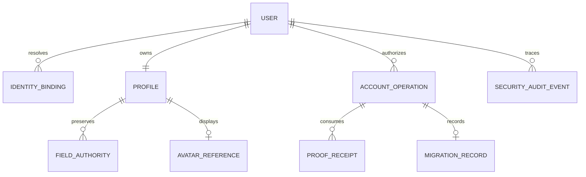

# Modelo de datos propuesto — 010

Solo diseño del modelo productivo; no clases productivas, migraciones EF ni cambios en BD MiKompri ejecutados. El spike posterior usa fixtures CIAM y BD local desechable aislada, sin alterar este modelo. Esquema actual en [auditoría](current-state-audit.md). [ADR](../../docs/adr/ADR-004-ciam-identity.md), [migración](migration.md) y [privacidad](privacy-and-deletion.md) gobiernan activación y retención.

Observación QA del30/10: el consumidor email OTP aparece en CIAM como `federated`/issuer `mail`, no `emailAddress`/password. Es un detalle del adapter CIAM, no un identificador canónico nuevo ni prueba de control por email. [Evidencia de representación y límites](evidence/aggregation-spike.md). No fijar esquema/migración a una representación inferida de la etiqueta «email»; ambas autenticaciones reales al mismo oid deben probarse antes del modelo final.

## Invariantes

1. User.Id Guid no cambia ni se regenera al migrar, vincular, recuperar o personalizar.
2. Una identidad confiable completa pertenece como máximo a un UserId, también con carreras. Nunca índice único de email como correlación.
3. A: un binding CIAM activo canónico por UserId; puente legado adicional temporal y separado. No lista propia de Google subjects/passwords.
4. B, solo si se aprueba: varios bindings del **mismo CIAM** por UserId. No convertirlo en múltiples proveedores JWT directos.
5. IdentityBinding solo nace de alta explícita nueva o migración/linking con pruebas; candidato de una operación nunca auto-provisiona User.
6. Last-method es invariante bajo lock/versión en Users y verificación CIAM; un factor MFA, correo de contacto o lista cacheada no cuenta como método primario válido.
7. No cascada de borrado de User sobre datos financieros/membresías; conservar tombstone/identificador cuando corresponda. El cascade actual de memberships no es estrategia de eliminación.

## Entidades lógicas

| Entidad | Campos propuestos | Restricciones y autoridad |
| --- | --- | --- |
| User | Id existente, AccountStatus (Active/Suspended/DeletionRequested/Deleted), SecurityVersion, TokensValidFromExclusive?, ProfileVersion, timestamps UTC | Id canónico; estado leído autoritativamente por request D1. SecurityVersion invalida pruebas/operaciones; no requiere nuevo claim CIAM. Corte de emisión aplica a todos sus bindings; estados no cambian roles |
| IdentityBinding | BindingId, UserId, ProviderNamespace, TrustedIssuerId, TenantId, ObjectId, Kind (CanonicalCiam/LegacyMigration), Status, TokensValidFromExclusive?, VerifiedAt, OperationId, Version | Clave única namespace+issuer+tid+oid normalizados según emisor confiable; issuer de config/metadata validada, no del cuerpo. Corte para este binding; Version invalida sus pruebas. Sin tuplas incompletas; unicidad/concurrencia |
| MigrationRecord | OperationId, UserId, OldBindingId, NewBindingId, State, Cohort, BeforeDigest, VerifiedAt, ActivatedAt, RetiredAt, Version | Journal de puente/retiro; no reasigna UserId ni copia ownership. Contiene IDs/digests mínimos, no tokens |
| AccountOperation | Id, Purpose, InitiatorUserId, SourceBindingId, CandidateBinding, Status, ExpiresAt, ExpectedVersion, idempotency fingerprint | Estados y resultados persistentes, claim de ejecución único; no datos destino elegidos por cliente |
| ProofReceipt | Id aleatorio, OperationId, Party (Source/Candidate/SurvivingAlternative), IssuerBinding, ChallengeStartedAt, AuthenticatedAt, EvidenceKind/PolicyVersion, assurance comprobada, ExpectedSecurityVersion/BindingVersion, consumedAt, expiresAt, nonce/state/challenge digest | No token MiKompri. Control <=300s al confirmar y operación <=600s; timestamp no anterior al reto salvo skew 30s. EvidenceKind solo auth_time CIAM con semántica G3 probada o challenge CIAM verificable aprobado. No callback time/iat/MFA histórica como AuthenticatedAt. Datos efímeros, sin tokens/OTP/códigos en journal |
| SecurityAuditEvent | ActorUserId, OperationId, acción/resultado/motivo, timestamps, IDs pseudónimos | No email, tokens, authorization code, claims completos ni fotos. Retención aprobada por política |
| ProfileFieldAuthority | UserId, Field, Source (Default/Provider/User), SourceBindingId?, ImportedAt?, CustomizedAt?, Version | Registra propiedad por campo; `User` siempre prevalece. Snapshot externo separado, mínimo y con política de expiración |
| AvatarReference | UserId, Kind (Initials/Provider/Custom), ObjectKey o referencia permitida, source, version | Nunca usar URL arbitraria como autoridad ni identificador; ownership servidor, política de imagen y fallback |

ProviderNamespace distingue workforce legado de External ID aunque ambos sean familia Entra. El `IdentityProvider` actual del User no se reutiliza como identidad social. Las columnas actuales se mantienen durante expansión como compatibilidad, con una única fuente efectiva de lectura según fase; no escrituras dobles incoherentes.

Precisiones [D1/D3](architecture-review.md): `TokensValidFromExclusive` es un corte de emisión server-side (segundos UTC), no tiempo de autenticación. Al suspender/reactivar, actualizar corte y versión relevantes; exigir JWT vigente y `iat > max(corte de cuenta, corte de binding)`. No ampliar por clock skew; token del mismo segundo puede requerir adquisición posterior. Sin iat donde hay corte, rechazar. No activar de nuevo tokens emitidos durante suspensión. Status/version no se cachean entre requests en beta; se permiten lecturas mínimas reutilizadas dentro de una petición. En A, un binding CIAM puede representar varios métodos: no prometer suspensión selectiva de tokens de un método social dentro del mismo oid; incidente puede requerir bloquear todo el binding. No cambia UserId ni se crea esquema ahora.

## Perfil MiKompri: campos y alcance

| Campo | Obligatoriedad / límite propuesto | Tratamiento |
| --- | --- | --- |
| DisplayName | Obligatorio, 1–100 caracteres, fallback «Usuario» | Inicialización opcional por claim; edición propia y precedencia User. No fallback al email para presentación pública |
| Username | Opcional en alta; si se elige, 3–30 caracteres, `[a-z][a-z0-9_]{2,29}` | Público opt-in, único case-insensitive tras trim/minúsculas, lista de reservados (admin/support/system/mikompri). `@` solo presentación. Índice único nullable; conflictos concurrentes 409. No login, no identificación por email, no búsqueda masiva de PII |
| GivenName / FamilyName | Opcionales, hasta 100 cada uno | Texto Unicode; no obligar apellido ni inferirlo separando DisplayName. Inicializar solo con claims de procedencia conocida |
| Avatar | Opcional; Initials por defecto | Provider puede inicializar si existe referencia fiable; no se presupone claim picture o permiso Graph. Custom o «quitar avatar» son personalización que no se sobrescribe |
| ContactEmail | Opcional, separado de login y nullable | Valor, Source, VerificationAuthority, VerifiedAt, VerificationState. Cambiarlo invalida verificación anterior; claim email/upn no prueba verificación. No recovery por este campo por sí solo |
| PreferredLanguage | Opcional; locale soportado, default producto actual | Lista admitida, no añadir internacionalización completa en 010 |
| Preferences | Opcionales y tipadas, defaults explícitos | Sin JSON arbitrario ilimitado ni claves de seguridad; solo opciones funcionales aprobadas |
| BirthDate | Extensión futura, no columna/recogida inicial | Fecha civil opcional solo con finalidad aprobada; no deducir edad desde proveedor |
| Phone / Address | Extensiones futuras, no persistencia inicial | No necesarios para compras. Verificación telefónica futura no convierte teléfono de perfil en MFA del IdP |

El email de login, factores, passwords, passkeys y estado de verificación de autenticación pertenecen al CIAM. Users guarda solo la información mínima acreditada para contacto/procedencia, no replica el almacén de credenciales.

## Sincronización y avatar

- Registro inicial: llenar campos no personalizados permitidos; guardar source. Si faltan, defaults neutros.
- Cada login: resolver identidad/estado; no modificar el perfil elegido. Snapshot mínimo del proveedor puede actualizarse separado y con versión.
- Sync explícito: mostrar diferencia por campo y obtener confirmación; importar solo selección sobre ProfileVersion vigente. Nunca inferir identidad o control de cuenta desde el snapshot.
- Edición/quitar campo/avatar: source=User, incluyendo supresión voluntaria; un null personalizado no se rellena después. «Restaurar desde proveedor» es una nueva acción explícita.
- Avatar propio, si se aprueba su entrega: object storage separado y claves opacas; JPEG/PNG/WebP <=5MiB, límites de dimensiones/decodificación, reencode/retirar EXIF, rechazo SVG/ejecutables, URLs de lectura según privacidad y autorización de subida/borrado por UserId. No guardar binario en JWT/Users table. No descargar URLs arbitrarias del usuario (SSRF); provider URL HTTPS con política allowlist o fallback a iniciales. No crear almacenamiento todavía.

## Diagrama lógico

Este diagrama expresa relaciones posibles, no cardinalidad ilimitada de A. En A el constraint de binding activo y Kind limita el estado estable; B relajaría esa cardinalidad mediante decisión y pruebas nuevas. MFA/métodos son inventario CIAM consultado, no una réplica Users que prometa disponibilidad.

## Persistencia futura

Expandir con tablas/columnas e índices aditivos; rellenar desde tuplas confiables ya acreditadas sin fabricar tid/oid. Inventariar legacy null/sub y ponerlos en resolución controlada. Usuarios existentes con cambios previos se consideran personalizados por defecto. PostgreSQL/Docker valida unicidad/carreras, backfill reanudable y no huérfanos. No ejecutar Down destructivo como rollback operativo. Datos y alias nuevos sobreviven rollback de tráfico; ningún consumidor accede directamente al nuevo esquema Users.
